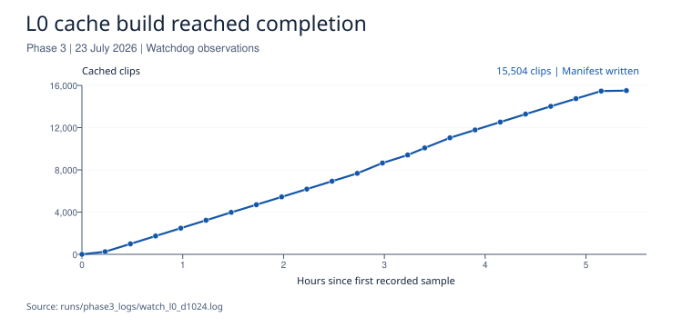
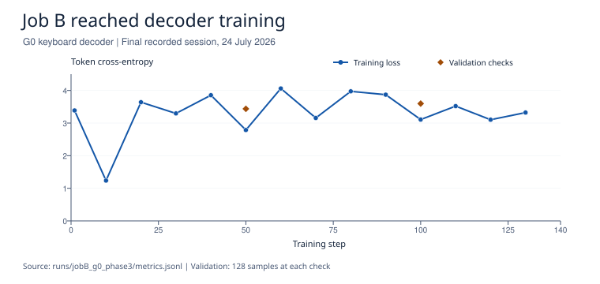

# deNote AMT

deNote AMT is a research prototype for local automatic music transcription (AMT) in deNote. Its goal is to turn polyphonic audio into note events with pitch, onset and offset times, MIDI velocity, and an instrument identifier. The project uses Rust and Burn.

## Why development stopped

The cache build completed, and the first decoder entered training. End-to-end note F1 was never measured, so the scaling experiment lacked a validated baseline.

Development of this prototype stopped before it could answer the main research question: would scaling the modular system to roughly **one billion parameters** improve transcription enough to outperform MIROS under the same evaluation protocol? The project reached training for individual modules, but it never produced a trained one-billion-parameter system or a controlled comparison against the smaller prototype and MIROS. It also established no result on MusicNet, which the data plan listed as a possible secondary validation dataset for real recordings.

The main architectural problem was the placement of instrument conditioning. The shared adapter received an instrument hint before the presence head, even though the head had to infer that hint from audio at inference time. The evaluation also reconstructed the decoders with a different feed-forward width from training. Both issues had to be resolved before a smaller model could serve as the scaling baseline. [Phase 3 evaluation plan](plans/PLAN_Phase3_Data_F1_vs_MIROS.md) · [Phase 5 scaling plan](plans/PLAN_Phase5_Scale_1B.md)

## What was implemented

- Audio loading and resampling, STFT, and log-mel features. Preparation of labeled clips from rendered MIDI and mixtures of instrument stems, with caches for audio features and target tokens.
- MIDI event tokenization and conversion back to notes. A finite state machine (FSM) constrains the next token, and a merge step combines outputs from different instrument groups.
- A convolutional frontend and Transformer encoder, an LSTM adapter, an instrument presence classifier, and separate Transformer decoders for instrument groups. The adapter includes auxiliary pitch and onset heads.
- Synthetic smoke tests, CPU and GPU training loops, JSONL logging, and checkpointing. Modular inference from cached features and a utility for evaluating Multi Onset F1.

## Where training stopped

| Stage | What the surviving run records show |
| --- | --- |
| Phase 0 platform check | The CUDA training check reached step 500. |
| L0 feature and token caching | The cache build reported 15,504 processed clips. |
| Job A: instrument presence | The shared adapter and multilabel presence head were trained and saved at step 5050 with `d_model = 1024`. The final validation logged macro and micro presence F1 of 1.0 on 512 samples under the original validation setup. |
| Job B: note transcription | The next stage started training the G0 keyboard decoder with the Job A modules frozen. The surviving log ends at step 130. |
| Job E: end-to-end evaluation | The evaluation utility was implemented. The documented experiments contain no final transcription score for a trained set of group decoders. |

Job A trained a classifier for the instrument classes present in a clip. Job B trained a decoder to predict the sequence of note events for one instrument group. [Job A plan](plans/PLAN_Phase1_Cache_JobA.md) · [Job B plan](plans/PLAN_Phase2_Modular_Decoders.md)

### Run evidence

The plots use measurements from the surviving run files. The [evidence CSV](docs/experiment/run-evidence.csv) records the plotted values, source paths, and timestamps, together with the checkpoint milestones and final Job A validation metrics.



**L0 completed.** The watchdog reported 15,504 cached clips and confirmed the manifest was present. This establishes that feature and token preparation ran at corpus scale.



**Job B ran after Job A.** The chart shows the final logged G0 session. The earlier starts have their own step counters. The final session recorded validation token cross-entropy of 3.437 at step 50 and 3.597 at step 100, with 128 validation examples at each check. The training log continued to step 130. Two validation points establish that the decoder was trained and evaluated at the token level. Its note-level transcription quality remained open.

### Architectural issue: instrument conditioning and presence gating

Instrument hints serve a useful purpose when a decoder already knows which group to transcribe. In v1, the presence head also read the output of that same instrument-conditioned adapter. The adapter sums embeddings for the supplied instrument IDs and adds them to the audio features before the recurrent layers. During Job A training and validation, the supplied IDs were the ground-truth labels that the presence head was asked to predict. At inference time, those labels are unavailable, so the classifier receives an all-zero hint instead. This creates both label leakage and a change in the classifier's inputs between validation and inference. [Instrument adapter](crates/denote-model/src/adapter.rs) · [Job A training and validation](crates/denote-train/src/jobs/job_a.rs) · [Presence gating in Job E](crates/denote-eval/src/main.rs)

```text
Job A validation: features + reference instrument IDs → adapter → presence head
Inference gate:  features + zero instrument hint       → adapter → presence head
                                                                        ↓
                  predicted instruments → select and condition group decoders
```

If the gate misses every active instrument in a group, it can skip that decoder entirely. Increasing decoder capacity cannot address that failure mode. The recorded presence score and the initial Job B loss therefore leave an unresolved question about the behavior of the assembled system on unseen audio.

One redesign to test would put the presence head on unconditioned audio features. Instrument conditioning would enter after the gate, where it can specialize the selected decoders. The experiment would compare the audio-only gate against decoding all groups on the same held-out clips, reporting instrument recall and Multi Onset F1. The redesign remains a proposal for a follow-up. [Planned gate ablation](plans/PLAN_Phase3_Data_F1_vs_MIROS.md)

A separate checkpoint compatibility issue also blocked evaluation of the decoder as trained. The Phase 3 config specifies a feed-forward width of `4 × d_model`, while Job E constructs a decoder with `2 × d_model`. Saving the model configuration with the checkpoint and using it in both training and evaluation would make the baseline comparable before changing the parameter count. [Phase 3 decoder configuration](configs/phase3_jobB_g0.toml) · [Job E model construction](crates/denote-eval/src/main.rs)

The raw datasets, caches, logs, and weights are excluded by `.gitignore` and are absent from a standard clone.

### Other limitations

- **MusicFM integration is incomplete.** `ConformerStack` uses Burn's standard `TransformerEncoder` with a convolutional frontend. L0 can read the MusicFM NumPy tensor inventory, but the tensors are never applied to the network parameters. The saved configurations built the cache with a randomly initialized encoder. [Encoder](crates/denote-encoder/src/conformer.rs) · [L0](crates/denote-train/src/jobs/cache_l0.rs)
- **The modular path from WAV to multi-instrument MIDI is incomplete.** The current CLI takes `--latent` and checkpoints. JSON retains the `program` field, while the MIDI exporter writes to a single channel without `ProgramChange` events. [Inference](crates/denote-infer/src/main.rs)

The next version can build on the audio preprocessing, note structures, tokenization, FSM, data preparation, and experiment tooling. The evaluation utility provides a starting point for measuring note and instrument recognition on held-out data.

## Denote-MIROS-v1 architecture

The prototype follows [MIROS / YourMT3+](https://arxiv.org/html/2603.27528v1#S4) with a shared encoder, a recurrent adapter, and decoders for instrument groups. [MuScriptor](https://huggingface.co/MuScriptor/muscriptor-large#model-description) served as a reference for future experiments. In this version, the decoders receive audio features through cross-attention. The decoder-only design with an audio prefix remained a proposal.

| Component | Implementation |
| --- | --- |
| Input | 24 kHz mono audio → 128-band log-mel spectrogram |
| Encoder | Two convolutions and roughly 4× temporal downsampling → Transformer encoder → features at approximately 25 Hz |
| Adapter | Instrument embeddings, an LSTM, and linear projections. Produces memory for cross-attention and auxiliary pitch and onset outputs |
| Presence | A multilabel classifier. A probability threshold determines whether to run a group's decoder |
| Decoders | Autoregressive MIDI token selection from a Transformer decoder with cross-attention. Each group has its own weights in modular mode |
| Post-processing | The FSM restricts valid events. Group outputs are converted to notes and merged |

```text
WAV → log-mel → CNN + Transformer → audio features (L0)
                                          ↓
                             LSTM adapter + presence (Job A)
                                          ↓
                          Group Transformer decoders (Job B_g)
                                          ↓
                            MIDI tokens → FSM → note events
```

The vocabulary includes `BOS`, `EOS`, `Program`, `TimeShift`, `Velocity`, `NoteOn`, and `NoteOff`. Note duration is calculated by subtracting the onset time from the offset time. The [group configuration](configs/groups_challenge8.toml) defines eight instrument classes and four decoder groups for the AMT Challenge.

| Group | Instruments |
| --- | --- |
| G0 | Piano |
| G1 | Violin, viola, cello |
| G2 | Flute, oboe, bassoon |
| G3 | Trombone |

The code includes a compact `DenoteMiros` variant with one decoder for smoke tests and `DenoteModular` with multiple decoders. The legacy `DenoteCrnn` follows the Onsets and Frames approach and predicts onsets, frames, and offsets. It is available through the `legacy-crnn` feature in `denote-model`.

## Workspace layout

| Path | Purpose |
| --- | --- |
| [denote-audio](crates/denote-audio) | Loading, resampling, STFT, and mel features |
| [denote-tokens](crates/denote-tokens) | Vocabulary, note encoding and decoding, and the FSM |
| [denote-encoder](crates/denote-encoder) | Convolutional frontend, Transformer, and weight dump loading |
| [denote-data](crates/denote-data) | Annotations, clips, mixtures, feature and token caches, and the legacy piano roll |
| [denote-model](crates/denote-model) | Adapter, presence classifier, Transformer decoders, and the legacy CRNN |
| [denote-decode](crates/denote-decode) | Token generation, note merging, and legacy frame decoding |
| [denote-eval](crates/denote-eval) | Note metrics and the Job E CLI |
| [denote-train](crates/denote-train) | Smoke tests, mini-training, corpus preparation, and training |
| [denote-infer](crates/denote-infer) | Modular inference from features, legacy inference from audio, and JSON/MIDI export |
| [configs/](configs) | TOML configurations for experiment runs |
| [START/](START) | Windows scripts to start, monitor, and resume runs |
| [plans/](plans) | Technical plans and notes on data preparation |

## Quick start on GPU with Vulkan

On Windows and Linux, the training CLI uses Vulkan through Burn's WGPU backend. Build with the `wgpu` feature and select `--device wgpu`. The examples use PowerShell. Run them from the repository root on a system with a Vulkan-capable GPU and driver.

The smoke test runs one teacher-forced optimization step on a one-second synthetic sine wave at 24 kHz paired with one MIDI note. The mini-training run repeats the synthetic loop and saves metrics and checkpoints in the run directory. Both runs work without a dataset download.

```powershell
# If cargo is not already on PATH
$env:Path = "$env:USERPROFILE\.cargo\bin;" + $env:Path

# Denote-MIROS seq2seq smoke test on Vulkan
cargo run -p denote-train --release --features wgpu -- `
  --config configs/miros_v1_smoke.toml --smoke --device wgpu

# Phase 0 mini-training on Vulkan, 100 steps
cargo run -p denote-train --release --features wgpu -- `
  --config configs/phase0_mini.toml --mini-steps 100 --device wgpu `
  --run-dir runs/phase0_mini_vulkan
```

The CLI reports `backend=wgpu`. With the project's Burn and CubeCL versions, WGPU selects Vulkan by default on Windows and Linux. On macOS, the same WGPU command selects Metal. The historical Phase 0 run in the evidence table used CUDA.

Metrics are written to `metrics.jsonl`. The original instructions used `tools/jsonl_to_tb.py` to import metrics into TensorBoard. That converter is absent from this copy. See the [resume guide](START/RESUME_GUIDE.txt) for checkpoint options.

### CPU fallback

Use the CPU path for smoke tests, debugging, or systems without a suitable GPU.

```powershell
cargo test --workspace --lib

cargo run -p denote-train --release -- `
  --config configs/miros_v1_smoke.toml --smoke --device cpu

cargo run -p denote-train --release -- `
  --config configs/phase0_mini.toml --mini-steps 100 --device cpu `
  --run-dir runs/phase0_mini_cpu

# Legacy CRNN smoke test
cargo run -p denote-train -- --config configs/v1_synth.toml --smoke
```

## Data and training

The pipeline separates the computation of audio features from the training of the adapter and decoders. L0 runs the frozen encoder once per clip and saves its feature sequence alongside the tokenized reference notes. Jobs A and B then read the same cached inputs. The manifest associates each clip with its split, cached artifacts, and instrument labels.

### Data sources in the plan

| Source | Intended role |
| --- | --- |
| Classical and multitrack MIDI rendered with FluidR3 | Generate labeled audio in a domain close to the AMT Challenge. MIDI supplies the program, pitch, onset, offset, and velocity annotations. |
| Slakh2100 stems | Build synthetic mixtures of different instruments. The Phase 3 implementation uses BabySlakh stems. |
| MusicNet and URMP | Optional fine-tuning or secondary validation on real multi-instrument recordings. |
| MAESTRO | Supplement piano data while keeping the broader training set balanced across instruments. |
| Phase 1 synthetic clips | Exercise the cache and training interfaces on a small set of audio and note pairs. |
| GuitarSet | Later adaptation and evaluation for guitar in deNote. |

The Phase 3 plan proposed cutting recordings into four- to five-second clips. It also proposed mixing up to three instrument stems, normalizing the summed audio, and combining their note annotations while retaining instrument IDs. The training curriculum would start with single-instrument clips, then admit clips with up to two and eventually three instruments. [Phase 3 data design](plans/PLAN_Phase3_Data_F1_vs_MIROS.md) · [Data preparation guide](plans/DATA_TRAINING_GUIDE.md)

### Training jobs

1. **Corpus preparation.** `phase3-data` renders MIDI through FluidSynth with FluidR3, mixes BabySlakh stems, or both. It produces pairs of `<id>.wav` and `<id>.notes.json` files. The Phase 3 configuration uses four-second clips. This stage requires source MIDI files or BabySlakh. Rendering also requires FluidSynth and a SoundFont. [Corpus configuration](configs/phase3_corpus.toml) · [Data preparation notes](plans/DATA_TRAINING_GUIDE.md)
2. **L0, `cache-l0`.** Computes features from the audio and tokens from the annotations, then writes `manifest.jsonl`. Phase 3 uses 1024-dimensional features and a four-layer encoder.
3. **Job A, `job-a`.** Trains the shared adapter and instrument presence classifier. Phase 3 introduces mixtures with one to three instruments as training progresses. The main configuration uses only the presence loss. This run leaves the auxiliary pitch and onset heads untrained.
4. **Job B, `job-b`.** Freezes the adapter and trains one decoder per run on tokens for that decoder's instrument group using teacher forcing. A [single-decoder configuration](configs/phase3_jobB_single.toml) is available for comparison.
5. **Job E, `denote-eval`.** Decodes cached validation features and compares the predicted notes with the reference annotations.

In Job A, a clip's presence target is an eight-element multi-hot vector. An instrument's entry is set if the clip contains a note for that program. The head pools the adapter output across time and predicts one logit per instrument. The presence objective uses binary cross-entropy. The Phase 1 plan also describes optional pitch and onset losses and a single-decoder warmup. [Job A architecture and losses](plans/PLAN_Phase1_Cache_JobA.md)

In Job B, each decoder sees note targets filtered to the instrument programs in its group. The training objective is token cross-entropy with padding ignored. The single-decoder baseline uses the full multi-program sequence and the same frozen adapter, so it can test whether group specialization helps. The roadmap also allowed a short joint fine-tuning pass, Job C, after the separate modules had been trained. [Group-specific targets and baseline](plans/PLAN_Phase2_Modular_Decoders.md)

The Phase 3 commands below use Vulkan for feature extraction and training once the source data is ready. Corpus preparation uses FluidSynth and runs separately. The Job E evaluation CLI uses the CPU backend.

```powershell
cargo run -p denote-train --release -- --config configs/phase3_corpus.toml --job phase3-data
cargo run -p denote-train --release --features wgpu -- --config configs/phase3_cache.toml --job cache-l0 --device wgpu
cargo run -p denote-train --release --features wgpu -- --config configs/phase3_jobA_ft.toml --job job-a --device wgpu
cargo run -p denote-train --release --features wgpu -- --config configs/phase3_jobB_g0.toml --job job-b --device wgpu
# Replace g0 with g1, g2, or g3 for the other groups
```

The TOML configurations specify the paths to data and checkpoints. The [Windows scripts guide](START/README.txt) lists the scripts for this sequence.

### MusicFM weights

The plan called for freezing a pretrained [MusicFM](https://github.com/minzwon/musicfm) encoder and converting its PyTorch weights offline. The loader expects `state_keys.json` and a `tensors/` directory containing `.npy` files. The `tools/convert_musicfm.py` script mentioned in earlier instructions is absent from the archived copy. Reproducing MusicFM also requires compatible layers, applying the weights to the model, and checking its outputs against the original implementation.

## Metrics

`denote-eval` provides onset and onset-plus-offset metrics. The Job E CLI computes **Multi Onset F1** by matching instrument, MIDI pitch, and onset within 50 ms. It takes a manifest, the Job A checkpoint directory, and a list of decoder checkpoints. You can change the presence threshold or bypass it with `--force-all`.

```powershell
cargo run -p denote-eval --release -- --help
```

The example below evaluates G0 after resolving the FFN mismatch described above. It requires the validation cache and both checkpoints. The model dimension, layer count, and attention head count must match the training configuration.

```powershell
cargo run -p denote-eval --release -- `
  --manifest data/cache/phase3/manifest.jsonl --split val `
  --job-a runs/jobA_phase3/checkpoints/last `
  --decoders runs/jobB_g0_phase3/checkpoints/last/decoder_g0 `
  --d-model 1024 --decoder-layers 2 --decoder-heads 16 `
  --onset-tol 0.05 --out runs/eval_phase3_g0
```

With one decoder, you can evaluate only its instrument group. For multi-instrument evaluation, pass the decoder checkpoint paths as a comma-separated list.

The Phase 3 plan uses MIROS's published AMT Challenge Multi Onset F1 of `0.5998` as an external reference. A direct comparison requires the same test set and scoring protocol. The planned report included precision, recall, and F1 by instrument, with macro averaging across instruments and optional micro F1 for analysis. Presence F1 and note-with-offset F1 answer separate questions. [Phase 3 evaluation protocol](plans/PLAN_Phase3_Data_F1_vs_MIROS.md)

### Planned comparisons

| Comparison | What it would test |
| --- | --- |
| Presence threshold vs. decoding all groups | Whether skipping unlikely instrument groups improves note precision and reduces predictions for absent instruments. |
| Group decoders vs. one decoder | Whether instrument specialization improves transcription on the same data. |
| Stem mixtures vs. FluidR3-only data | Whether cross-stem augmentation improves transcription of mixed audio. |
| FSM constraints enabled vs. disabled | Whether constrained decoding improves valid note-event sequences and note-level scores. |
| Smaller modular system vs. scaled modular system | Whether added capacity improves quality when the validation cache and scoring protocol are held fixed. |

The plans separated these tests so an improvement from a data or architecture change would not be attributed to parameter count alone. [Phase 3 ablations](plans/PLAN_Phase3_Data_F1_vs_MIROS.md) · [Phase 5 evaluation protocol](plans/PLAN_Phase5_Scale_1B.md)

## Planned path to one billion parameters

The scaling target was approximately **0.9–1.1 billion parameters across the assembled system**. The Phase 5 plan distinguished total model size from the parameters updated in an individual training job. Total size would include the encoder, shared adapter, presence head, and every group decoder, including any optional experts or adaptation parameters.

1. **Increase decoder capacity.** Train deeper decoders or expand their feed-forward layers one group at a time. Keeping the decoder's input dimension fixed would allow the existing adapter and encoder features to be reused.
2. **Try one decoder per instrument.** Split the four groups into eight, rebuild group-specific token targets, and train a separate decoder for each instrument.
3. **Test optional changes separately.** Explore mixture-of-experts feed-forward layers inside selected decoders and LoRA or partial fine-tuning of the encoder.
4. **Measure capacity and quality together.** Count the parameters of the assembled bundle and of each training job. After each major change, run inference and Job E on the fixed Phase 3 validation set. The planned comparison paired a smaller modular system in the same size class as MIROS with the scaled system.

The milestone required a loadable model bundle and a documented quality comparison. These steps remained part of the roadmap. [Phase 5 scaling plan](plans/PLAN_Phase5_Scale_1B.md)

## deNote integration

`NoteEvent` carries onset and offset times in seconds, MIDI pitch, and velocity. The product plan proposed packaging the encoder, adapter, presence head, and decoders with a manifest, vocabulary, group definitions, and inference settings. The intended interface took a WAV file and returned JSON notes with optional MIDI output. Integration with Tauri alongside Demucs and ONNX packaging were planned options.

For long recordings, the proposed inference path used overlapping windows, with four-second windows and a two-second hop as an example. Each window's predicted note times would be shifted to the recording's timeline. The merge step would identify duplicates by instrument, pitch, and onset proximity. [Phase 4 product design](plans/PLAN_Phase4_Product.md)

The data guide also describes the difference between a clean labeled recording and a separated stem. Separation can introduce artifacts and leave bleed from other instruments. The proposed adaptation starts from labeled recordings or synthetic data, passes the corresponding audio through Demucs, and fine-tunes on the separated versions while retaining the original note annotations. GuitarSet was the planned starting point for guitar adaptation. [Data preparation guide](plans/DATA_TRAINING_GUIDE.md) · [GuitarSet fine-tuning plan](plans/PLAN_Phase4_Product.md)

## Historical plans

| Stage | Document |
| --- | --- |
| Overall architecture, evaluation objectives, and training sequence | [Denote Free Modular](plans/PLAN_Denote_Free_Modular.md) |
| 0. Validate Rust/Burn, GPU support, logging, and checkpointing | [Platform Proof](plans/PLAN_Phase0_Platform_Proof.md) |
| 1. Cache features and train the adapter | [Cache & Job A](plans/PLAN_Phase1_Cache_JobA.md) |
| 2. Train instrument group decoders | [Modular Decoders](plans/PLAN_Phase2_Modular_Decoders.md) |
| 3. Scale up the dataset and evaluate against MIROS | [Data & F1](plans/PLAN_Phase3_Data_F1_vs_MIROS.md) |
| 4. Complete inference and export, then fine-tune on GuitarSet | [Product](plans/PLAN_Phase4_Product.md) |
| 5. Scale the system to about 1 billion parameters | [Scale to 1B](plans/PLAN_Phase5_Scale_1B.md) |

The plans record the original experiment goals. Scaling, LoRA, and product integration remained planned work.
